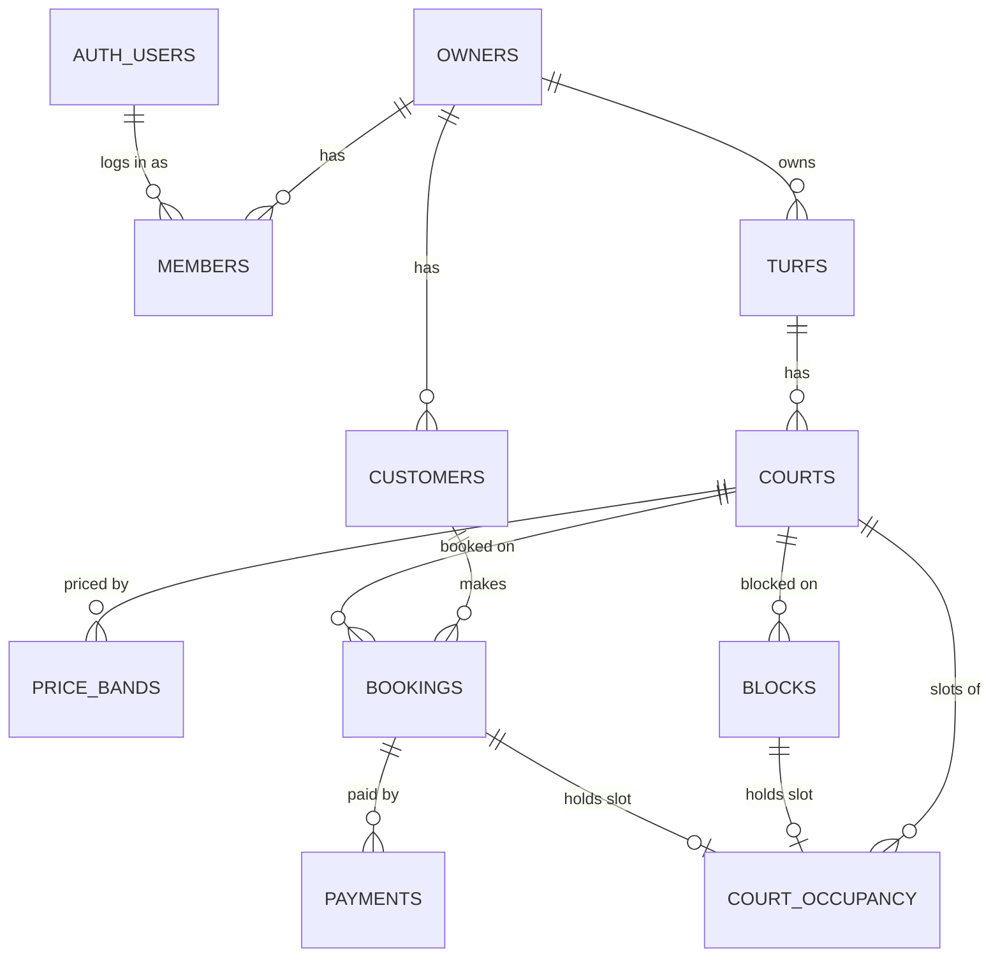

# Database schema: tables and relations

Source of truth is `supabase/migrations/`. This page is a readable map of it. Rules, RLS and the overlap constraint are explained in `DATABASE.md`.
`*` = required column. `owner_id` is on every table except `owners`.

## Relationship map

In words: **owner → turfs → courts → (price bands, bookings, blocks)**. A booking also points to a **customer** and has many **payments**. Every booking or block keeps one **court_occupancy** row, and that table is what stops two bookings overlapping.

## Tables

| Table | What it is | Key columns | Belongs to |
|---|---|---|---|
| **owners** | One business account (tenant) | name*, phone*, email, status* (active/inactive), plan* (free/starter/pro), plan_started_at, plan_renews_at | none (top level) |
| **members** | Links a login user to an owner | user_id*, role* (`owner` only), phone, email | owners, auth.users |
| **turfs** | A turf location and its booking rules | name*, booking_code (unique), address, maps_link, hold_minutes* (default 5), advance_type/value*, cancellation_policy, reminder_hours*, summary_time* | owners |
| **courts** | A bookable court in a turf | name* (unique per turf), sport, slot_minutes*, open_time*, close_time*, base_price*, active* | turfs |
| **price_bands** | Peak / off-peak price of a court | days_of_week*, start_time*, end_time*, price*, tag, whatsapp_bookable* | courts |
| **customers** | A player the owner has booked | name*, phone* (unique per owner), notes | owners |
| **bookings** | One reservation of a court | court_id*, customer_id, time_range*, status*, source*, price*, price_overridden*, notes, created_by, cancel_reason, hold_expires_at, payment_order_id (unique), payment_proof_url | courts, customers |
| **blocks** | Time a court is unavailable | court_id*, time_range*, reason, created_by | courts |
| **payments** | Money recorded on a booking | booking_id*, amount*, mode* (online/cash/UPI), type* (advance/balance/refund), gateway, gateway_payment_id (unique), recorded_by, paid_at* | bookings |
| **court_occupancy** | System table behind the no-overlap rule (app never writes it) | court_id*, time_range*, booking_id or block_id | courts, bookings, blocks |
| **audit_log** | Who changed what, filled by triggers | table_name*, row_id*, action*, changed_by, old_data, new_data | owners |

## Foreign keys

| From | Points to | On delete |
|---|---|---|
| members.owner_id | owners.id | cascade |
| members.user_id | auth.users.id | cascade |
| turfs.owner_id | owners.id | cascade |
| customers.owner_id | owners.id | cascade |
| courts (turf_id, owner_id) | turfs (id, owner_id) | cascade |
| price_bands (court_id, owner_id) | courts (id, owner_id) | cascade |
| bookings (court_id, owner_id) | courts (id, owner_id) | none |
| bookings (customer_id, owner_id) | customers (id, owner_id) | none |
| blocks (court_id, owner_id) | courts (id, owner_id) | none |
| payments (booking_id, owner_id) | bookings (id, owner_id) | cascade |
| court_occupancy.court_id | courts.id | cascade |
| court_occupancy.booking_id | bookings.id | cascade |
| court_occupancy.block_id | blocks.id | cascade |
| bookings / blocks `created_by`, payments `recorded_by` | auth.users.id | set null |

**Why two columns in most keys:** a child points to its parent with `(id, owner_id)`, so a row can never belong to a different owner than its parent. This is the owner-isolation guarantee behind RLS.

## Other rules to remember
- Unique: `turfs.booking_code`, `(turf_id, courts.name)`, `(owner_id, customers.phone)`, `(owner_id, user_id)` on members.
- `court_occupancy` has an exclusion constraint: no two rows with the same `court_id` and overlapping `time_range`. A clash fails with error 23P01.
- Money is integer rupees. All times are `timestamptz` (UTC), shown in `Asia/Kolkata`.
- Staff accounts are not in Phase 1, so `members.role` allows only `owner`.
